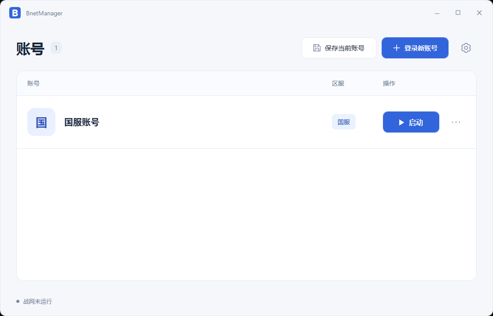

# BnetManager

Windows 战网多账号切换工具，保存各账号的本地登录状态，切换后自动启动官方战网。

[下载最新版本](https://github.com/noxmew/BnetManager/releases/latest)



## 功能

- 保存、启动和切换多个账号。
- 提供国服、亚服、美服和欧服的登录入口。
- 编辑账号备注、更新登录状态、移除本地记录。
- 加密保存登录快照，操作失败或中断时尝试自动恢复。

## 使用

运行环境为 Windows 11，目前已在 x64 上验证。需先安装并启动一次官方战网；程序未找到安装位置时，在右上角设置中选择 `Battle.net.exe`。

1. 在官方战网登录账号，勾选「保持登录」，再点击「保存当前账号」。
2. 添加其他账号时，先保存当前账号，再点击「登录新账号」选择区服；完成登录后保存。
3. 点击账号右侧的「启动」或「切换」即可使用该账号。
4. 「…」菜单可以更新登录状态、修改备注或移除本地记录。

保存和切换前请先退出游戏。程序会自动暂时退出战网，操作完成后按需重新打开。四区服均有登录配置，尚未完成所有区服的完整登录实测；登录状态失效时，需要在官方战网重新登录。

数据位于 `%LOCALAPPDATA%\BnetManager`。`accounts.json` 为明文账号目录，`.session` 为加密登录快照；请妥善保管，不要公开上传。快照供原电脑、原 Windows 用户及原战网安装目录使用。

如果提示操作中断，退出游戏和战网后重新打开 BnetManager，让程序完成自动恢复；不要删除 `pending.session`。

## 构建

使用 C#、WPF 和 .NET 10 SDK：

```powershell
dotnet build src/BnetManager/BnetManager.csproj -c Release
```

仓库的 GitHub Actions 工作流会自动构建 Windows x64 和 ARM64 自包含压缩包，无需单独安装 .NET。推送与项目版本一致的 `v*` 标签时，自动发布到 [Releases](https://github.com/noxmew/BnetManager/releases)。ARM64 尚未完成实机验证。
